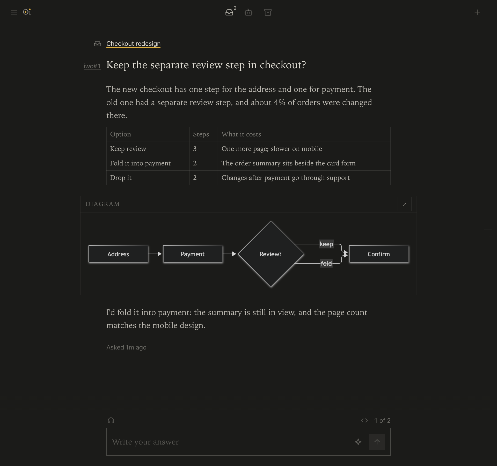

# Operator Inbox

A local inbox for the questions your agent sessions ask you. Each session posts its questions to an Inbox, you answer them in a local web app, and the session picks the answers up and carries on.

Questions that scroll away in a long agent session get lost, and several sessions asking at once are hard to keep up with. Operator Inbox holds them all in one place, outside the transcripts, with enough context to answer each one cold: markdown, tables, diagrams, drawings and attached files.

It runs on your machine only: a CLI, an event log on one SQLite file, and a web app on http://127.0.0.1:7184. It is built for Claude Code sessions, and works from any agent that can run a command.



Work in progress.

## How it works

An agent session opens an Inbox (`operator-inbox open`) and asks each question there (`operator-inbox ask`). You answer in the app at http://127.0.0.1:7184. The session runs `operator-inbox watch` once, which wakes it when an answer lands. It acts on the answer, then marks the Question done (`operator-inbox done`). Turn on inbox mode (`operator-inbox mode on`) and the app's Claude Code hooks keep every question for you in the Inbox, not the chat.

`operator-inbox skill` prints the full instructions an agent follows. `operator-inbox --help` lists every command. `docs/architecture.md` describes how it is built.

## Quick start

You need Node 22.16 or later and pnpm 9 or later. The launch agent that keeps the server running, and the optional desktop window, are macOS only; elsewhere you run `operator-inbox serve` yourself.

```sh
git clone https://github.com/tomjamesallen/operator-inbox.git
cd operator-inbox
bash scripts/setup.sh
```

That installs and builds, links the `operator-inbox` bin, writes and loads a launch agent that serves http://127.0.0.1:7184, and merges the app's hooks into `~/.claude/settings.json` (backing it up first; `--no-hooks` skips that). Then install the skill for Claude Code:

```sh
mkdir -p ~/.claude/skills/operator-inbox
operator-inbox skill > ~/.claude/skills/operator-inbox/SKILL.md
```

and type `/operator-inbox` in a Claude Code session. It opens an Inbox, and its questions arrive in the app.

[`docs/install.md`](docs/install.md) is the full guide: requirements, what `setup.sh` does step by step, the desktop window, listen mode (Questions read aloud by a local voice), updating, where your data lives, and uninstalling.

## Updating

```sh
git pull
bash scripts/setup.sh rebuild
```

`rebuild` builds and restarts the running server onto the new build, and changes nothing else. Reinstall the skill afterwards, with the `operator-inbox skill` line above.

## Troubleshooting

```sh
operator-inbox doctor
```

checks the install: Node, the bin on `PATH`, `config.json`, the event log, the server, the launch agent, the Claude Code hooks, the skill, the desktop window, listen mode's voice and the widgets' commands. Each row reads `ok`, `warn` or `fail`, with a one-line fix. It changes nothing, exits non-zero when a row fails, and takes `--json`. [`docs/install.md`](docs/install.md#troubleshooting) covers the common cases.

## Configure

Nothing is needed to start. To change anything, edit the files in `~/.config/operator-inbox/` (under `$XDG_CONFIG_HOME` when that is set):

- `config.json`: this machine's settings, such as `databasePath` to move the store, `serve.tailnet` to reach the app from your other devices through `tailscale serve`, and `inboxMachines` to show another machine's Inboxes here. `readout.voice` is listen mode's voice. Display settings live there too: `chaseAfterMinutes`, and `diagramSize` (diagram size: `"box"`, the default, fills the box a picture may take; `"area"` also limits its area, so a tall or a wide picture takes about the same room), and `priorityPull`, how the page pulls you back to the priority Inbox after an answer elsewhere (`"interjection"`, the default, shows a card saying what waits there; `"boomerang"` goes straight there and back), and `wideBlocks`, how a table or a picture wider than the text widens (`"both"`, the default, centres it on the text and grows it both ways while there is room, then to the right; `"right"` keeps it to the text's left edge and grows it right only, as code blocks always do), and `sendKey`, which key sends from the answer, follow-up and ask boxes (`"mod+enter"`, the default, sends on ⌘↩ or Ctrl+↩, as the keybindings bind Send, and Enter is a new line; `"enter"` sends on Enter, and ⇧↩, ⌘↩ and Ctrl+↩ are a new line). Either way, Enter while an input method is composing never sends, and in a macro card's field Enter is a new line and Send's keybinding sends.
- `metadata.json`: the metadata keys your Inboxes and Questions carry. `operator-inbox keys` shows the rules in force.
- `keybindings`: your own key bindings for the page.
- `widgets.json`: small commands whose output the sidebar shows, such as the load or a disk's use, each with a label, a command and how often it runs; its output is text, or JSON mapped through templates. Serve runs them only while the sidebar is open. `operator-inbox widgets` checks the file and prints what will run, and [`docs/widgets.md`](docs/widgets.md) has every field. A widget's output is visible to every peer `serve.tailnet.allowFrom` names, so a command that prints a secret should not be one.
- `macros.json`: your macros, slash commands for the answer box, the ask box and a comment. Each has a name, a line saying what it is for, an instruction for the agent and its parameters, each a closed list of options (one of them, or with `"multiple": true` any of them), text or a number; every parameter is required unless it says `"required": false`. Type `/` at the start of a word in the answer box, in the box where you ask the agent a question, or in a comment on a Question's text, to pick one; a comment's macros act on the text it quotes, and a comment may be macros alone. `operator-inbox macros` checks the file and prints what it offers.

```json
{
  "macros": [
    {
      "name": "todo",
      "description": "Add a to-do for me",
      "instruction": "Add this to the operator's to-do list, tied to this question's work, at the given priority (1 is the highest).",
      "params": [
        { "name": "text", "type": "text", "placeholder": "what to do" },
        { "name": "priority", "type": "number", "min": 1, "max": 4, "default": 2, "required": false }
      ]
    },
    {
      "name": "park",
      "description": "Park this thread",
      "instruction": "Stop work on this thread. Write down where it stands, and pick it up only when the operator asks.",
      "params": []
    }
  ]
}
```

`operator-inbox info` prints where everything is.

## Develop

```sh
pnpm install
pnpm verify
```

`pnpm verify` runs Biome, the type check, the Effect check, every test and the build. `AGENTS.md` holds the codebase's rules, and `GLOSSARY.md` its words.

## Issues

Bug reports and ideas are welcome as issues. Pull requests from outside are not taken for now.

## Licence

BSD-3-Clause. See `LICENSE`.
