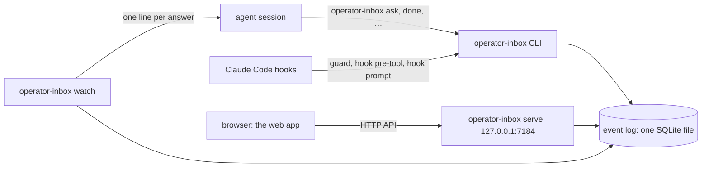

# Architecture

How Operator Inbox is put together. `GLOSSARY.md` defines the domain words used here: Inbox, Question, queue, inbox mode, watcher, metadata rules.

## The shape



Everything runs on one machine, for one operator. The CLI and the server are the same binary. Both read and write one event log, and neither holds state of its own beyond what they fold from that log.

## Packages

A pnpm and Turborepo monorepo:

| Package | Path | What it holds |
| :-- | :-- | :-- |
| `@operator-inbox/core` | `packages/core` | The domain: the inbox events, the fold that turns them into state, the decisions that turn a command into events, the metadata rules, the keymap, the config schema and the HTTP API's schema. Pure where it can be, and safe to import in the browser except where a module says otherwise. |
| `@operator-inbox/cli` | `apps/cli` | The `operator-inbox` binary: the commands agents call, the hooks, the watcher, the store wiring, and `serve`, which hosts the API and the web build. |
| `@operator-inbox/web` | `apps/web` | The single-page app the operator answers in, built with Vite and served by the CLI. |

## The event log

State is event-sourced. Every change is an event appended to one log, a kairos-es store on one SQLite file (by default `~/.local/state/operator-inbox/inbox.sqlite`, tables prefixed `operator_inbox`). Its events include `InboxOpened`, `QuestionAsked`, `QuestionAnswered`, `AnswerProcessed`, `QuestionWithdrawn`, `QuestionEdited`, `QuestionMoved`, `QuestionHighlighted`, `InboxRenamed`, `InboxArchived`, `GroupArchived`, `InboxMuted`, `InboxPinned`, `InboxPriorityMarked`, `InboxPriorityCleared`, `InboxModeOn` and `InboxModeOff`, each a tagged schema in `packages/core/src/inbox.ts`.

A command is a decision over the events it reads. Core's `decide…` functions take an Inbox's folded state and a request, and return either the events to append or a refusal (`InboxRefusal`) naming why. The store (`apps/cli/src/inbox-store.ts`) reads the events a decision needs, by tag, and appends its result on the condition that nothing it read has changed since. On a conflict it reads again and decides again. So the consistency boundary is what each decision reads, not a fixed aggregate: opening an Inbox under a name reads the name as well as the Inbox, so two sessions cannot take the same name; marking the priority Inbox reads the log's one priority tag as well as the Inbox, and replaces the old mark in the same append, so the log never holds two (ADR-0006).

Views are folds. The list of Inboxes the page and `operator-inbox list` show is a read model: derived tables in the same SQLite file (`<prefix>_rm_inbox`, one row per Inbox holding its folded state and its last activity; `<prefix>_rm_question`, one row per Question with its state and times as real columns, so `operator-inbox stats` is one query; and `<prefix>_rm_checkpoint`, the log position folded up to and the fold version) kept by `apps/cli/src/inbox-read-model.ts`. The CLI and the server both write the log, so there is no one subscriber: any process that lists catches the rows up first, reading the log after the checkpoint (usually nothing), folding those events with core's `evolveInbox`, and writing the rows and the new checkpoint in one transaction on the condition that the checkpoint has not moved; a process that loses the race reads again. The rows are never the truth: when the stored fold version is not the one in code, or the checkpoint is past the log's head, they are dropped and folded again from the start. A decision never trusts them either: opening under a name reads the rows to find the name's likely holder, but its append is still conditioned on the name's tag. One Inbox's own view is still folded from its events on demand. The encoded form of every event is pinned by golden files (`packages/core/test/golden/`, `apps/cli/test/golden/`), so a change to an event's shape fails a test before it can strand a log already on disk.

## The CLI

`apps/cli/src/commands/` holds one module per command group, built with `effect/cli`. The commands an agent calls (`open`, `ask`, `answers`, `done`, `withdraw`, `edit`, `highlight`, `move`, `meta`, `archive`, `group archive`, `mode`, `watch`, `wait`) each run one decision against the store and print a short result. A refusal exits non-zero with one line naming what is missing. Before `ask` and `edit` decide anything, they parse each ```mermaid fence in the body with Mermaid itself, under a happy-dom window (`src/mermaid-check.ts`), and refuse a body holding a diagram the page could not draw.

`operator-inbox skill` prints the skill an agent reads (`apps/cli/assets/SKILL.md`). The skill and the classifier prompt ship inside the CLI package, and are found relative to it rather than through a checkout.

## The server

`operator-inbox serve` listens on 127.0.0.1:7184 only. It serves the HTTP API, whose schema is core's (`packages/core/src/api/`), and the web build, which it finds relative to the CLI package. A `Host` and `Origin` guard refuses any request that does not name the address it is bound to, so a page on another origin cannot drive it. Other devices reach it only through `tailscale serve`, from the peers `serve.tailnet.allowFrom` names in `config.json`.

The server can also show the Inboxes of other machines (`inboxMachines` in `config.json`). Each stays in its own machine's log. This server reads and writes them through an SSH tunnel that `operator-inbox tunnel <machine>` opens. An Inbox id that two machines both claim is refused on both, rather than guessed at.

Listen mode's audio is made by the server, on request (`apps/cli/src/readout.ts`). The page builds each Question's speech script and POSTs the ones it wants to `/api/readout`, the current Question first; the server makes them one at a time, in that order, through a `ReadoutVoice` port (`readout-voice.ts`), and answers where each stands. The one voice today is Kokoro through mlx-audio, a Python child (`apps/cli/assets/readout-kokoro.py`) started on the first request, spoken to in JSON lines, and stopped after five idle minutes (it holds the model, about 800 MB) or with serve. Each script is made at a pace: the current Question `now`, at full speed; the lookahead in the `background`, as a background process to macOS that rests between segments, since the model runs on the GPU and a long run at full speed starves the window server. The MP3s and their word timings are a cache keyed by a hash of the voice and the script, under `readout/` in the state folder, served with `Range` from `/api/readout/audio/<hash>.mp3`. They are derived, so they are not events on the log.

Widgets are run by the server too (`apps/cli/src/serve-widgets.ts`, `docs/widgets.md`). A `WidgetRunner`, built on the first request as listen mode's voice is, reads `widgets.json` fresh on every read, decodes it with core's `decodeWidgetsFile` (each entry on its own, a bad one dropped), and reconciles: one fibre per widget in a `FiberMap`, a widget whose command or schedule changed restarted once its old process has gone, a removed one interrupted. Only a file that is there and decodes deletes a removed widget's cache; a missing or unreadable one stops every widget and keeps them. Each fibre runs its command as `/bin/bash -c` through the spawner, in its own process group, waits the interval from the run's end, and runs again, so no two runs of a widget overlap; a refresh while it runs queues one more. A run past its timeout has its group sent SIGTERM, then SIGKILL 1.5s later; 8 KB of stdout and the last line of stderr are kept, and a `json` widget with templates has its output mapped to the envelope there (`widget-template.ts` in core). Scheduled runs are skipped once 15s pass with no `watching` read, the open sidebar's; `POST /api/widgets/opened` runs every widget bar one running or run in the last 5s. Runs live in memory, with the last good one of each widget cached under `widgets/` in the state folder so a restart is not blank; they are derived, so they are not events on the log (ADR-0007). `GET /api/widgets` answers every machine's widgets in one snapshot: Local's, and each Inbox machine's, read through its tunnel with `local=true` (`fetchMachineWidgets`), `watching` passed on only when the page's read is. A run of another machine's widget is forwarded to it by id (`forwardWidgetRun`); the API never takes a command.

Files the operator attaches to an answer, a follow-up or a question they ask travel whole, as base64, in that write's own request, so a write sent on to the machine that holds the Inbox takes its files with it (`apps/cli/src/inbox-attachments.ts`). The server plans where each goes from its bytes (`<store folder>/attachments/<inbox id>/<first 16 hex of its SHA-256>/<safe name>`), decides the write on that plan, writes each file whole and renames it into place, and only then decides again and appends the event, which carries each file's path, name, media type and size and never its bytes. A refused write writes nothing; an append that fails after the files are written leaves only the files. `GET /api/attachments/<inbox>/<hash>/<name>` reads one back for the page: a raster image as itself, anything else as a download. A file of an Inbox another machine holds is not in Local's folder, so when Local's log lacks the Inbox too, Local sends the read on to the machine the board recorded as claiming it (`apps/cli/src/serve-attachments.ts`), over its tunnel with `local=true` as every forwarded call is, and sends the bytes back with its own type and headers, never the machine's. Reaching the machine is bounded by the read timeout, the bytes by a minute and by the most one file may take; a machine that cannot be reached is a 503 carrying a short sentence, never cached, and the page shows that thumbnail as the file's card saying it could not be read. A read carrying `local=true` is never sent on, so a machine's serve that predates this answers Local's read from its own folder as it always has. An agent's `ask --attach` and `edit --attach` keep its files the same way, from the CLI straight into the store's folder: plan, decide on the plan, write, then decide and append. They ride on the agent's `QuestionAsked` and `QuestionEdited` as `attachments` (on an edit, the whole new set), and the fold holds them as `askedAttachments`, apart from the files the operator's answer carries. When serve renders a body, an `attachment:<name>` image source becomes that file's `/api/attachments/…` URL if the Question carries an image of that name; any other `attachment:` source renders as its alt text. A Question another machine holds is rendered again on Local (core's `machineView`), its images drawn from its own `askedAttachments` at Local's URLs, which read them through Local. Such an image carries the file's name (`data-attachment-image`) and is a focusable button, and the page opens it in the same lightbox as a thumbnail. Beside the rendered body, serve sends `bodyImages`: the names of the files the body shows in place, read from its markdown (`packages/core/src/attachment-images.ts`, the same names the renderer marks) and kept only where the image resolved. The page leaves each of those files out of the strip under the body. A machine's `bodyImages` is discarded with its HTML, and Local's own rendering names them again.

## The web app

A Vite single-page app in React, styled with Tailwind v4 and built on Base UI components. State lives in Effect Atom atoms and XState machines, not in hand-wired hooks. The page polls the API for the board, keeps a draft per Question, and answers through the API. Its key bindings are a keymap: the defaults, with the user's `keybindings` file applied in order. Its macros come from `macros.json`, which serve hands over as text (`GET /api/macros`) and the page decodes with core's `decodeMacrosFile`, as the CLI's `operator-inbox macros` does; an answer, or a question the operator asks the agent, carries each macro invoked, its instruction copied in (`macros.ts` in core). The sidebar's widgets are read on the board's poll while the sidebar is out, as `watching`, and opening it, or `Ctrl+R` while it is out, asks serve to run them all (`widgets.ts`); a machine that misses a read keeps its last widgets, greyed. A run's output is read in its widget's format (`widget-output.ts`): ANSI colours onto the theme's own, or the JSON envelope, always as text. An answer may also carry the operator's comments on spans of the Question's body (`comments.ts` in core); the page draws each span as boxes behind the text, from the selection's `Range`, and never changes the body's HTML. A comment or macro card removed from an answer can be brought back (`card-undo.ts`): ⌘Z takes the answer's newest removal while nothing has been done to the answer since, and is the browser's own undo otherwise; the undo stack is per answer, in memory, and cleared on send.

## Hooks, inbox mode and the watcher

`operator-inbox install-claude-hooks` merges three hooks into the user's Claude Code settings: `operator-inbox guard` on Stop, `operator-inbox hook pre-tool` before `AskUserQuestion` and the next-step box, and `operator-inbox hook prompt` on each prompt the user types. They act only for a session whose inbox mode is on. Then they refuse a question asked outside the Inbox, send back a turn that ends on one (the Stop hook asks a small model whether the last message asks the operator something, and fails open), and allow inline questions for the one reply after the user types.

`operator-inbox watch` is the watcher: a long-lived process a session starts once. It waits on the log and prints one line when an answer or an operator's own Question arrives, which the session's harness turns into a wake-up. It records itself under `~/.local/state/operator-inbox/inbox-watchers/`, so the Stop hook can tell whether one is running. It stops when its owning session's process goes away, or at its deadline.

## Config and data

| Where | What |
| :-- | :-- |
| `~/.config/operator-inbox/config.json` | this machine's settings: `databasePath`, `serve.tailnet`, `inboxMachines`, `readout.voice`, and the page's `chaseAfterMinutes`, `diagramSize`, `priorityPull`, `wideBlocks` and `sendKey` |
| `~/.config/operator-inbox/metadata.json` | the metadata rules (optional; the built-in defaults otherwise) |
| `~/.config/operator-inbox/keybindings` | key overrides, one binding per line (optional) |
| `~/.config/operator-inbox/macros.json` | the macros the answer box offers (optional; none otherwise) |
| `~/.config/operator-inbox/widgets.json` | the sidebar's widgets, and the `path` their commands run with (optional; none otherwise; `docs/widgets.md`) |
| `~/.local/state/operator-inbox/` | the event log, `inbox-sessions/` and `inbox-watchers/` |
| `~/.local/state/operator-inbox/attachments/` | the files the operator attached to answers and questions, and the agent to its questions, at `<inbox id>/<hash>/<name>` beside the store (it moves with `databasePath`); each event names its files by path, so they are never swept |
| `~/.local/state/operator-inbox/readout/` | listen mode's audio cache: `<hash>.mp3` and `<hash>.json`, derived and swept, never events |
| `~/.local/state/operator-inbox/widgets/` | each widget's last good run, `<id>.json`, so a restart is not blank: derived and swept, never events |

`XDG_CONFIG_HOME` and `XDG_STATE_HOME` move them, as usual. The app only reads the preference files, so they may be symlinks into a repo you keep them in. Nothing is read from or written to the checkout at run time. Environment variables are read through Effect's `Config`, and all are named `OPERATOR_INBOX_*`.
