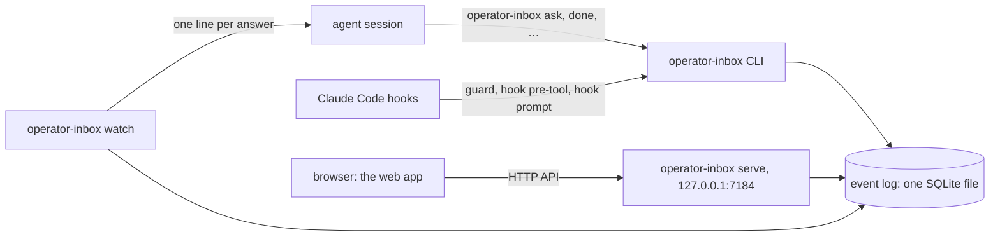

# Architecture

How Operator Inbox is put together. `GLOSSARY.md` defines the domain words used here: Inbox, Question, queue, inbox mode, watcher, metadata rules.

## The shape



Everything runs on one machine, for one operator. The CLI and the server are the same binary. Both read and write one event log, and neither holds state of its own beyond what they fold from that log.

## Packages

A pnpm and Turborepo monorepo:

| Package | Path | What it holds |
| :-- | :-- | :-- |
| `@operator-inbox/core` | `packages/core` | The domain: the inbox events, the fold that turns them into state, the decisions that turn a command into events, the metadata rules, the keymap, the config schema and the HTTP API's schema. Pure where it can be, and safe to import in the browser except where a module says otherwise. |
| `@operator-inbox/cli` | `apps/cli` | The `operator-inbox` binary: the commands agents call, the hooks, the watcher, the store wiring, and `serve`, which hosts the API and the web build. |
| `@operator-inbox/web` | `apps/web` | The single-page app the operator answers in, built with Vite and served by the CLI. |

## The event log

State is event-sourced. Every change is an event appended to one log, a kairos-es store on one SQLite file (by default `~/.local/state/operator-inbox/inbox.sqlite`, tables prefixed `operator_inbox`). Its events include `InboxOpened`, `QuestionAsked`, `QuestionAnswered`, `AnswerProcessed`, `QuestionWithdrawn`, `QuestionEdited`, `QuestionMoved`, `QuestionHighlighted`, `InboxRenamed`, `InboxArchived`, `GroupArchived`, `InboxMuted`, `InboxPinned`, `InboxModeOn` and `InboxModeOff`, each a tagged schema in `packages/core/src/inbox.ts`.

A command is a decision over the events it reads. Core's `decide…` functions take an Inbox's folded state and a request, and return either the events to append or a refusal (`InboxRefusal`) naming why. The store (`apps/cli/src/inbox-store.ts`) reads the events a decision needs, by tag, and appends its result on the condition that nothing it read has changed since. On a conflict it reads again and decides again. So the consistency boundary is what each decision reads, not a fixed aggregate: opening an Inbox under a name reads the name as well as the Inbox, so two sessions cannot take the same name.

Views are folds. The read model the page and `operator-inbox list` show is folded from the log on demand. The encoded form of every event is pinned by golden files (`packages/core/test/golden/`, `apps/cli/test/golden/`), so a change to an event's shape fails a test before it can strand a log already on disk.

## The CLI

`apps/cli/src/commands/` holds one module per command group, built with `effect/cli`. The commands an agent calls (`open`, `ask`, `answers`, `done`, `withdraw`, `edit`, `highlight`, `move`, `meta`, `archive`, `group archive`, `mode`, `watch`, `wait`) each run one decision against the store and print a short result. A refusal exits non-zero with one line naming what is missing. Before `ask` and `edit` decide anything, they parse each ```mermaid fence in the body with Mermaid itself, under a happy-dom window (`src/mermaid-check.ts`), and refuse a body holding a diagram the page could not draw.

`operator-inbox skill` prints the skill an agent reads (`apps/cli/assets/SKILL.md`). The skill and the classifier prompt ship inside the CLI package, and are found relative to it rather than through a checkout.

## The server

`operator-inbox serve` listens on 127.0.0.1:7184 only. It serves the HTTP API, whose schema is core's (`packages/core/src/api/`), and the web build, which it finds relative to the CLI package. A `Host` and `Origin` guard refuses any request that does not name the address it is bound to, so a page on another origin cannot drive it. Other devices reach it only through `tailscale serve`, from the peers `serve.tailnet.allowFrom` names in `config.json`.

The server can also show the Inboxes of other machines (`inboxMachines` in `config.json`). Each stays in its own machine's log. This server reads and writes them through an SSH tunnel that `operator-inbox tunnel <machine>` opens. An Inbox id that two machines both claim is refused on both, rather than guessed at.

## The web app

A Vite single-page app in React, styled with Tailwind v4 and built on Base UI components. State lives in Effect Atom atoms and XState machines, not in hand-wired hooks. The page polls the API for the board, keeps a draft per Question, and answers through the API. Its key bindings are a keymap: the defaults, with the user's `keybindings` file applied in order. Its macros come from `macros.json`, which serve hands over as text (`GET /api/macros`) and the page decodes with core's `decodeMacrosFile`, as the CLI's `operator-inbox macros` does; an answer carries each macro invoked, its instruction copied in (`macros.ts` in core). An answer may also carry the operator's comments on spans of the Question's body (`comments.ts` in core); the page draws each span as boxes behind the text, from the selection's `Range`, and never changes the body's HTML.

## Hooks, inbox mode and the watcher

`operator-inbox install-claude-hooks` merges three hooks into the user's Claude Code settings: `operator-inbox guard` on Stop, `operator-inbox hook pre-tool` before `AskUserQuestion` and the next-step box, and `operator-inbox hook prompt` on each prompt the user types. They act only for a session whose inbox mode is on. Then they refuse a question asked outside the Inbox, send back a turn that ends on one (the Stop hook asks a small model whether the last message asks the operator something, and fails open), and allow inline questions for the one reply after the user types.

`operator-inbox watch` is the watcher: a long-lived process a session starts once. It waits on the log and prints one line when an answer or an operator's own Question arrives, which the session's harness turns into a wake-up. It records itself under `~/.local/state/operator-inbox/inbox-watchers/`, so the Stop hook can tell whether one is running. It stops when its owning session's process goes away, or at its deadline.

## Config and data

| Where | What |
| :-- | :-- |
| `~/.config/operator-inbox/config.json` | this machine's settings: `databasePath`, `serve.tailnet`, `inboxMachines` |
| `~/.config/operator-inbox/metadata.json` | the metadata rules (optional; the built-in defaults otherwise) |
| `~/.config/operator-inbox/keybindings` | key overrides, one binding per line (optional) |
| `~/.config/operator-inbox/macros.json` | the macros the answer box offers (optional; none otherwise) |
| `~/.local/state/operator-inbox/` | the event log, `inbox-sessions/` and `inbox-watchers/` |

`XDG_CONFIG_HOME` and `XDG_STATE_HOME` move them, as usual. The app only reads the preference files, so they may be symlinks into a repo you keep them in. Nothing is read from or written to the checkout at run time. Environment variables are read through Effect's `Config`, and all are named `OPERATOR_INBOX_*`.
